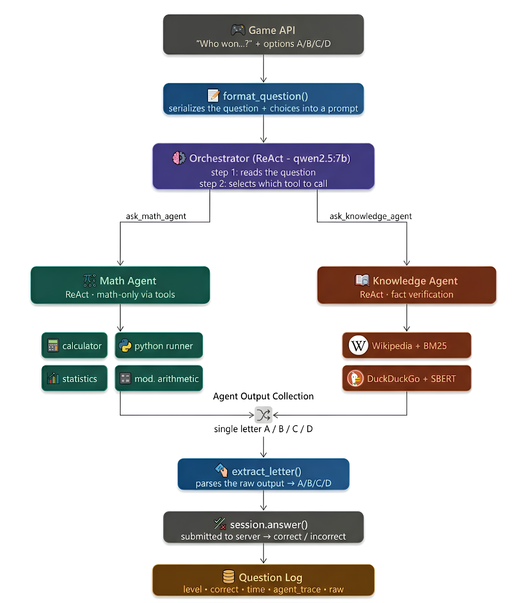

# PoliMillionaire: LLM Agents for a Quiz Game

  
This repository contains open-source LLM systems that play **PoliMillionaire**, a *Who Wants to Be a Millionaire*-style quiz. Questions come from a game server through an API: 4 options, 15 increasing levels, 6 categories, and a **30-second limit** per answer.

Starting from a plain zero-shot baseline, we improved the system one experiment at a time: model choice, prompting, calibration analysis, retrieval, tool use, fine-tuning and multi-agent orchestration. The result is a final **category-aware architecture** that picks the best strategy for each type of question.

All inference runs **locally on open-weight models** (Hugging Face `transformers` and Ollama). No external LLM APIs are used. As a reference point, random guessing scores 25 %.

## Highlights

| What | Result |
|---|---|
| **Adaptive Category-Specific Routing**: best prompt / RAG / tool chosen per category | **41.7 %** overall accuracy, up from a 28.7 % single-model baseline |
| **Hybrid-Math**: the LLM writes and executes Python code, and falls back to reasoning | Best Maths strategy: **~83 %** on the Maths benchmark (zero-shot ~60 %, CoT ~70 %) |
| **LoRA fine-tuning** of Qwen2.5-7B on MathQA + MMLU-Pro (MLX, r = 8) | **~70 % → ~77 %** on the Maths benchmark |
| **ReAct multi-agent system**: Orchestrator → MathAgent / KnowledgeAgent (LangGraph) | **37.6 %** over 196 live questions, 82.7 % on Philosophy & Psychology |
| **Calibration analysis** | ECE 0.088, Brier score 0.145 |

## Experiments

The main notebook, [`notebooks/polimillionaire.ipynb`](notebooks/polimillionaire.ipynb), presents the experiments in order. Each one states a question, runs the code, plots the results and discusses them.

> If GitHub cannot render the notebook (it is large), open it on [**nbviewer**](https://nbviewer.org/github/CompagnoniAndrea/polimilionaire/blob/main/notebooks/polimillionaire.ipynb).


| # | Experiment | Question it answers |
|---|---|---|
| 0 | Baseline | How good is a small model out of the box? |
| 1 | Model comparison | Is bigger always better? Does 4-bit quantization pay off? |
| 2 | Prompt engineering | Zero-shot vs few-shot vs CoT vs role-playing vs tone |
| 3 | Category analysis | Where does the model fail, and why? |
| 4 | Difficulty & overconfidence | Is the model calibrated? (ECE, Brier score) |
| 5 | RAG (Wikipedia) | Entity-based queries with relevance filtering: when does retrieval help, and when does it hurt? |
| 6 | Adaptive routing | Best strategy per category: the final single-model system |
| + | Math strategies | 13 strategies on a fixed maths benchmark (CoT, code execution, ensembles, R1 reasoning models, LoRA) |
| + | Multi-agent system | ReAct orchestrator with math tools and Wikipedia / DuckDuckGo search |
| + | RAG benchmarking | Which external knowledge base retrieves useful context? |
| + | Audio questions | Regex-cleaned speech transcripts fed to the routing system |

## Deep dive: the Maths category

Maths was by far the weakest category. Questions are university-level: modular arithmetic, probability, statistics, linear algebra. Many of them need an actual computation, and an LLM tends to *guess* the most familiar-looking number. Live games return different questions every time, so we built a **fixed benchmark of real Maths questions** with known answers and compared 13 strategies under identical conditions.

**The winning idea: compute first, then reason (Hybrid-Math)**

```
question ─► LLM writes a short Python program ─► run it in a subprocess
             ├─ result matches an option        → answer immediately
             ├─ result is plausible             → pass it as a hint to step 2
             └─ error / out-of-range result     → discard it
          ─► chain-of-thought reasoning ─► parse "Answer: X"
```

What made the difference:
- **Plausibility check**: an out-of-range result is dropped instead of misleading the reasoning step.
- **Automatic imports**: `math`, `numpy`, `itertools`, `Fraction`… are added to the generated code.
- **Robust answer parsing**: an early CoT version scored almost zero because of a parsing bug alone.

**Lessons learned**
- **Tool use beats everything else.** The code-first pipelines (~81–83 %) clearly outperform the best pure chain-of-thought model (~70 %), and neither ensembles nor prompt wording closes the gap.
- **Thinking models are accurate but slow.** DeepSeek-R1 7B exceeds the 30-second limit, and the 1.5B version is fast but reasons poorly.
- **The fallback model matters.** A good code generator paired with a weak reasoner does worse than one capable model doing both.
- **Fine-tuning helps a single model** (~70 % → ~77 %), but it does not reach code execution.
- **Few-shot retrieval is not a free win.** MMLU examples differ in style from the game's questions, and embeddings match vocabulary, not mathematical structure.

The full list of strategies is in the *Math Strategies* section of the main notebook and in [`02_math_strategies.ipynb`](notebooks/experiments/02_math_strategies.ipynb).

## Multi-agent architecture

<p align="center"></p>

The **Orchestrator** reads each question and hands it to a specialist. The **MathAgent** has calculation tools; the **KnowledgeAgent** has Wikipedia and DuckDuckGo retrieval. The chosen letter goes back to the game API. Every run is logged to JSON for later analysis.

## Repository structure

```
.
├── notebooks/
│   ├── polimillionaire.ipynb            # main notebook: all experiments and conclusions
│   └── experiments/                     # standalone notebooks for each line of work
│       ├── 01_baseline.ipynb
│       ├── 02_math_strategies.ipynb
│       ├── 03_multi_agent.ipynb
│       ├── 04_multi_agent_summary.ipynb
│       ├── 05_rag_benchmark.ipynb
│       └── 06_audio_acsr.ipynb
├── millionaire_client/                  # API client for the game server (provided by the course)
├── docs/
│   └── multi_agent_architecture.png
├── requirements.txt
└── .env.example
```

## Getting started

```bash
pip install -r requirements.txt
cp .env.example .env        # fill in POLI_USER and POLI_PASS
jupyter notebook notebooks/polimillionaire.ipynb
```

Most experiments were run on **Google Colab (T4 GPU)**, with models served through Hugging Face `transformers` or **Ollama**. The fine-tuning step used **MLX** on Apple Silicon. You need an account on the course's game server to play live games.

The development history of the multi-agent system is on the [`multi-agent-dev`](../../tree/multi-agent-dev) branch.

## Team

- **Andrea Compagnoni** 
- **Davis Crippa** 
- **Alice Berta**
- **Andri Salillari**

Natural Language Processing project, Politecnico di Milano, A.Y. 2025/26.


